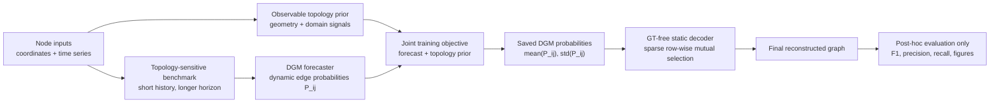
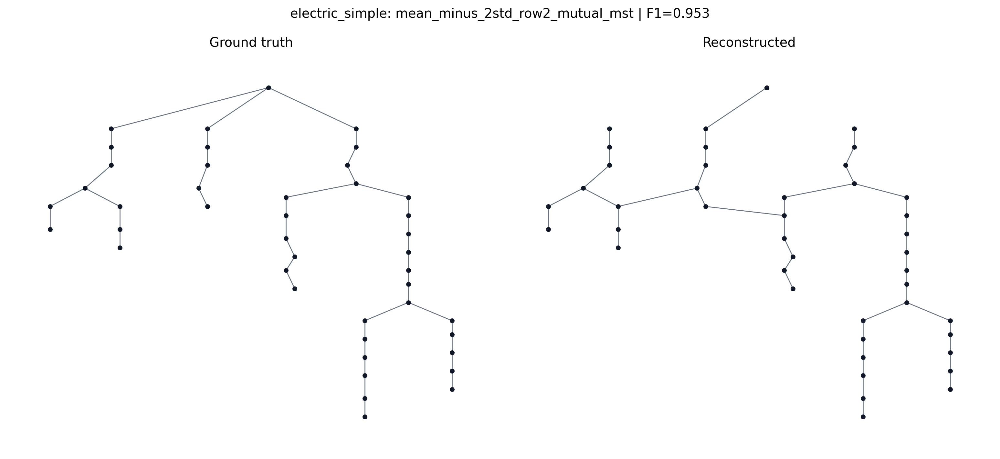
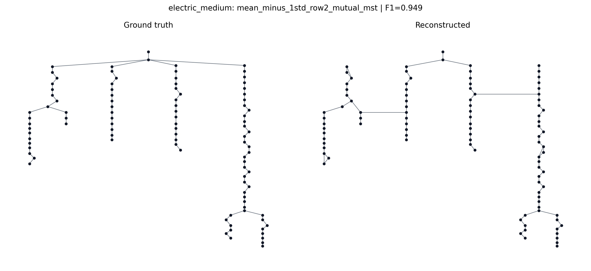
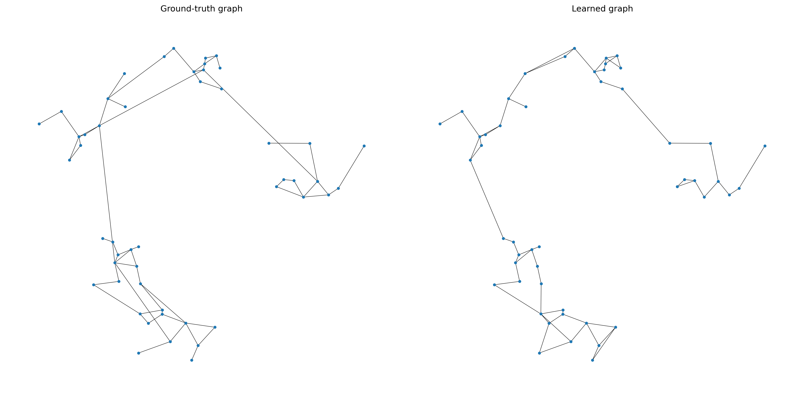
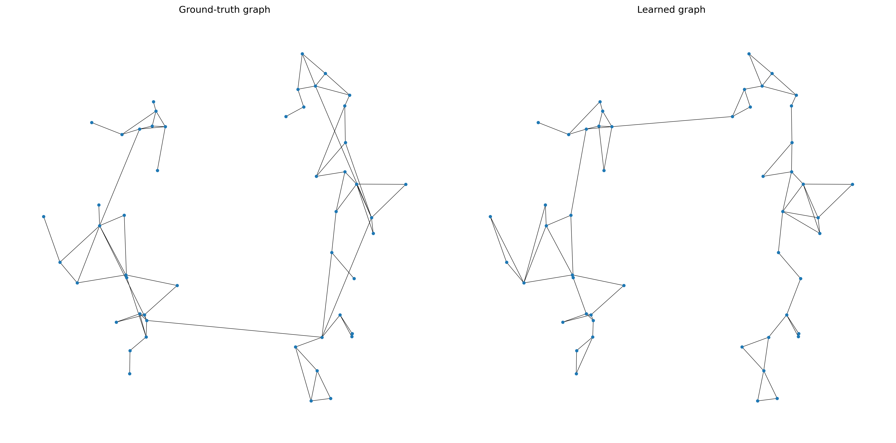
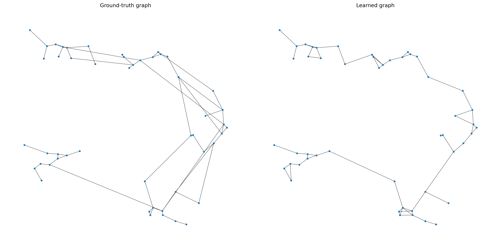

# Graph Water Recon / W-DGM

Graph topology reconstruction from node coordinates and node-level time series.

This project studies whether a Dynamic Graph Module (DGM) can learn a useful hidden graph while solving a forecasting task. The original setting is water-like: pressure and demand are observed at nodes, coordinates are known, and pipe connections are hidden. The same pipeline is now tested on electric-grid-like benchmarks, where voltage plays the role of the smooth network variable and active load plays the role of demand.

The central protocol is strict: ground-truth edges are never used during training, loss construction, observable-prior construction, candidate selection, checkpoint selection, hyperparameter choice, decoder selection, or post-processing. Ground truth is used only after the fact for final metrics and figures.

## Architecture Overview



The current final graph decoder is simple and transparent. It uses the average edge probability produced by the DGM and penalizes edges that vary strongly across batches:

```text
score_ij = mean(P_ij) - beta * std(P_ij)
```

A sparse row-wise decoder then extracts a static graph, usually with mutuality and an optional geometric MST to keep the reconstruction connected. A trainable consensus learner is also implemented as a diagnostic, but the stability-aware explicit decoder is currently stronger.

## Benchmarks

The repository contains two benchmark families:

| Family | Variables | Goal | Notes |
| --- | --- | --- | --- |
| Water-like | pressure, demand | reconstruct hidden pipe topology | original controlled setting |
| Electric-like | voltage, active load | reconstruct hidden grid topology | SimBench/pandapower and synthetic variants |

Tracked electric datasets are stored under `data/synthetic/electric_*`. They are small controlled benchmarks and are versioned with the repository.

## Average Results

The table below reports compact average topology/task results for the current representative sweeps. The electric averages use the stability-aware saved-probability decoder. The water average summarizes the current water DGM snapshot reported in the project docs.

| Domain | Benchmarks | Avg task MSE | Avg F1 | Avg precision | Avg recall | Avg Eval 0.5 |
| --- | ---: | ---: | ---: | ---: | ---: | ---: |
| Water-like | 3 | 0.263 | 0.783 | 0.814 | 0.756 | 0.787 |
| Electric-like | 8 | 0.467 | 0.845 | 0.888 | 0.814 | 0.764 |

`Eval 0.5` is a compact post-hoc score with equal weight on task quality and topology reconstruction. It is not used for training.

## Electric Results

Fixed setup for the latest electric sweep:

- DGM modules: `mlp + gcn`
- task loss: Huber with target normalization
- topology prior: complete electric observable prior
- decoder: stability-aware saved-probability decoder
- GT usage: post-hoc metrics and figures only

| Dataset | Task MSE | F1 | Precision | Recall | Eval 0.5 |
| --- | ---: | ---: | ---: | ---: | ---: |
| `electric_simple` | 0.412 | 0.953 | 0.953 | 0.953 | 0.831 |
| `electric_intermediate` | 0.454 | 0.860 | 0.825 | 0.897 | 0.774 |
| `electric_medium` | 0.480 | 0.949 | 0.930 | 0.969 | 0.812 |
| `electric_loopy` | 0.618 | 0.800 | 0.777 | 0.825 | 0.709 |
| `electric_mesh_simple` | 0.419 | 0.848 | 0.955 | 0.764 | 0.777 |
| `electric_mesh_medium` | 0.511 | 0.782 | 0.881 | 0.703 | 0.722 |
| `electric_synth_branch` | 0.468 | 0.829 | 0.927 | 0.750 | 0.755 |
| `electric_synth_mesh` | 0.376 | 0.738 | 0.852 | 0.650 | 0.732 |

Representative electric reconstructions:





## Water Results

Fixed setup for this water sweep:

- DGM modules: `gcn + gcn`
- task loss: Huber with target normalization
- topology prior: complete water observable/expert prior
- decoder: stability-aware saved-probability decoder
- GT usage: post-hoc metrics and figures only

  
| Dataset | Task MSE | F1 | Precision | Recall | Eval 0.5 |
| --- | ---: | ---: | ---: | ---: | ---: |
| `water_base` | 0.234 | 0.787 | 0.814 | 0.762 | 0.798 |
| `water_bridges` | 0.268 | 0.800 | 0.794 | 0.806 | 0.794 |
| `water_loopy` | 0.286 | 0.761 | 0.836 | 0.699 | 0.769 |

Representative water reconstructions:







## Repository Layout

```text
.
├── data/synthetic/           # Tracked small synthetic benchmarks
├── docs/                     # Protocols, methodology notes, result summaries
├── docs/figures/             # Lightweight summary figures
├── scripts/diagnostics/      # Proxy tests, decoder sweeps, consensus diagnostics
├── scripts/electric/         # Electric benchmark generators
├── scripts/experiments/      # DGM training and benchmark runners
├── scripts/synthetic/        # Water-like synthetic benchmark generators
├── scripts/water/            # Graph comparison and water-specific utilities
└── src/                      # DGM training, losses, datasets, model helpers
```

Generated training outputs, checkpoints, virtual environments, and large experiment sweeps are ignored by Git.

## Setup

```bash
python -m venv WDGM
source WDGM/bin/activate
pip install -r requirements.txt
```

PyTorch Geometric wheels may depend on your local CUDA/CPU setup. If installation fails, install the matching PyG wheels first, then rerun the requirements install.

## Typical Commands

Generate electric benchmarks:

```bash
python scripts/electric/generate_simbench_electric.py
python scripts/electric/generate_synthetic_electric.py
```

Run one electric DGM experiment:

```bash
python scripts/experiments/run_train_synthetic.py \
  --data_dir data/synthetic/electric_synth_mesh \
  --out_dir outputs/example_electric_run \
  --run_name example_electric_run \
  --num_nodes 52 \
  --lags 4 \
  --prediction_window 12 \
  --max_epochs 16 \
  --batch_size 16 \
  --task_loss_type huber \
  --task_feature_normalization target_std \
  --alpha_forecast 0.8 \
  --lambda_soft_pseudo_edge 0.5 \
  --pseudo_score_mode observable_electric_full \
  --pseudo_use_static_target \
  --pseudo_candidate_k 8 \
  --pseudo_topk 3 \
  --pseudo_include_mst \
  --coordinate_embedding_dim 4 \
  --ffun mlp \
  --gfun gcn \
  --export_soft_graph \
  --save_soft_score \
  --static_row_k 3 \
  --static_symmetry mutual \
  --static_include_mst
```

Evaluate saved probability decoders:

```bash
python scripts/diagnostics/evaluate_saved_prob_decoders.py \
  --run_root outputs/electric_full_grid \
  --out_csv outputs/electric_full_grid_decoder_eval/decoder_results.csv \
  --dataset_dir electric_synth_mesh=data/synthetic/electric_synth_mesh \
  --gamma 0.5 \
  --betas 0 0.5 1 2 \
  --row_ks 2 3 \
  --symmetries mutual union \
  --mst_options 0 1
```

Export summary figures for the best saved-probability decoders:

```bash
python scripts/diagnostics/export_saved_prob_decoder_figures.py \
  --decoder_csv outputs/electric_full_grid_decoder_eval/decoder_results.csv \
  --run_root outputs/electric_full_grid \
  --out_dir docs/figures/electric_decoders
```

## Documentation

Useful starting points:

- `docs/TOPOLOGY_SENSITIVE_BENCHMARK_PROTOCOL.md`
- `docs/SIMBENCH_ELECTRIC_BENCHMARK_PROTOCOL.md`
- `docs/TRAINABLE_CONSENSUS_LEARNER.md`
- `docs/PROXY_LANDSCAPE_DIAGNOSTIC.md`
- `docs/PROXY_METHODOLOGY_STUDY.md`

## Current Takeaway

The reconstruction ceiling is limited by the information available from observable quantities: coordinates, node dynamics, and domain knowledge. The electric results suggest that voltage/load dynamics contain enough topology signal to make the approach portable beyond water networks. The final static decoder still matters substantially, and the strongest current choice is the transparent stability-aware decoder.
