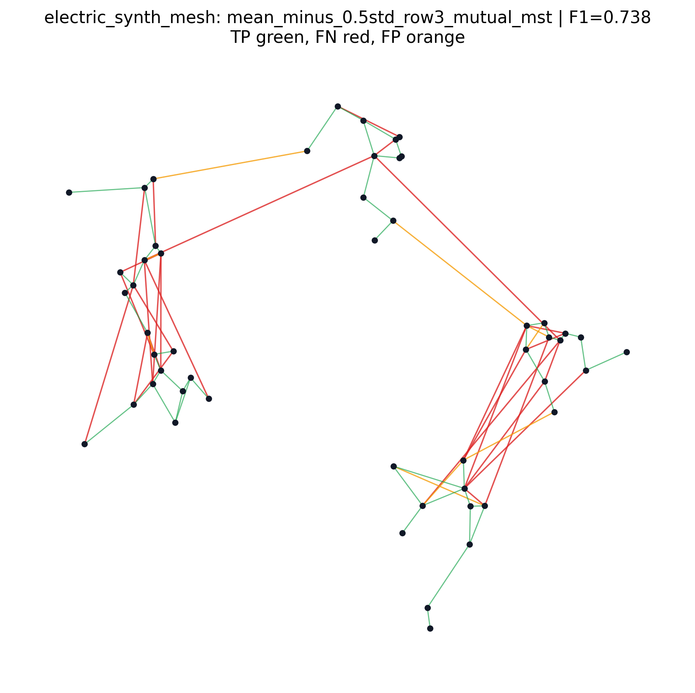

# Graph Water Recon / W-DGM

Graph topology reconstruction from node coordinates and node-level time series.

The project studies whether a Dynamic Graph Module (DGM) can learn a useful hidden topology while solving a forecasting task. The original benchmark is water-like: pressure and demand signals are observed at nodes, coordinates are known, and pipe connections are hidden. The same architecture is now also tested on electric-grid-like benchmarks, where voltage behaves like the smooth network variable and active load behaves like demand.

The central rule is simple: ground-truth edges are never used during training, loss construction, proxy construction, candidate selection, checkpoint selection, hyperparameter choice, decoder selection, or post-processing. Ground truth is used only after the fact for metrics and figures.

## Current Pipeline

The current architecture has three pieces:

1. A DGM forecaster that predicts future node variables from short histories.
2. An observable topology prior built from coordinates and domain-observable signals.
3. A GT-free static decoder that turns DGM edge probabilities into one final graph.

For the final graph, the strongest current decoder uses the mean DGM edge probability and penalizes batch-to-batch instability:

```text
score_ij = mean(P_ij) - beta * std(P_ij)
```

Then a sparse row-wise mutual decoder, usually with an optional geometric MST, extracts the static graph. This decoder is simple, transparent, and currently stronger than the trainable consensus learner.

## Benchmarks

Tracked benchmark families:

- Water-like synthetic networks: base, bridges, loopy, and held-out variants.
- Electric SimBench/pandapower networks: simple, intermediate, medium, loopy, and mesh variants.
- Electric synthetic networks: branch and mesh cases designed to be closer to water-like topology.

Electric datasets are generated with:

```bash
python scripts/electric/generate_simbench_electric.py
python scripts/electric/generate_synthetic_electric.py
```

The generated electric benchmark datasets are small enough to keep in the repository under `data/synthetic/electric_*`.

## Recent Electric Results

Fixed setup for the latest electric sweep:

- DGM modules: `mlp + gcn`
- task loss: Huber, target-normalized
- topology prior: complete electric observable prior
- final score: equal weight on task quality and topology F1
- GT usage: post-hoc metrics and figures only

| Dataset | Best decoder | Task MSE | F1 | Precision | Recall | Eval 0.5 |
| --- | --- | ---: | ---: | ---: | ---: | ---: |
| `electric_simple` | `mean - 2std`, row2 mutual MST | 0.412 | 0.953 | 0.953 | 0.953 | 0.831 |
| `electric_intermediate` | mean, row2 mutual MST | 0.454 | 0.860 | 0.825 | 0.897 | 0.774 |
| `electric_medium` | `mean - 1std`, row2 mutual MST | 0.480 | 0.949 | 0.930 | 0.969 | 0.812 |
| `electric_loopy` | `mean - 1std`, row2 mutual MST | 0.618 | 0.800 | 0.777 | 0.825 | 0.709 |
| `electric_mesh_simple` | `mean - 1std`, row2 mutual MST | 0.419 | 0.848 | 0.955 | 0.764 | 0.777 |
| `electric_mesh_medium` | `mean - 2std`, row2 mutual MST | 0.511 | 0.782 | 0.881 | 0.703 | 0.722 |
| `electric_synth_branch` | `mean - 1std`, row3 mutual no-MST | 0.468 | 0.829 | 0.927 | 0.750 | 0.755 |
| `electric_synth_mesh` | `mean - 0.5std`, row3 mutual MST | 0.376 | 0.738 | 0.852 | 0.650 | 0.732 |

Representative electric reconstructions:




## Water Results Snapshot

The water branch benchmarks remain the original controlled test bed. Current work keeps the DGM training joint, with two-stage experiments treated only as diagnostics.

Example water-like reconstructions:


## Repository Layout

```text
.
├── data/synthetic/           # Tracked small synthetic benchmarks
├── docs/                     # Protocols, methodology notes, result summaries
├── docs/figures/             # Lightweight summary figures for papers/slides
├── scripts/diagnostics/      # Proxy tests, decoder sweeps, consensus diagnostics
├── scripts/electric/         # Electric benchmark generators
├── scripts/experiments/      # DGM training and benchmark runners
├── scripts/synthetic/        # Water-like synthetic benchmark generators
├── scripts/water/            # Graph comparison and water-specific utilities
└── src/                      # DGM training, losses, datasets, model helpers
```

Generated training outputs, checkpoints, and large experiment sweeps are ignored by Git.

## Setup

```bash
python -m venv WDGM
source WDGM/bin/activate
pip install -r requirements.txt
```

PyTorch Geometric wheels may depend on your local CUDA/CPU setup. If installation fails, install the matching PyG wheels first, then rerun the requirements install.

## Typical Commands

Run one electric DGM experiment:

```bash
python scripts/experiments/run_train_synthetic.py \
  --data_dir data/synthetic/electric_synth_mesh \
  --out_dir outputs/example_electric_run \
  --run_name example_electric_run \
  --num_nodes 52 \
  --lags 4 \
  --prediction_window 12 \
  --max_epochs 16 \
  --batch_size 16 \
  --task_loss_type huber \
  --task_feature_normalization target_std \
  --alpha_forecast 0.8 \
  --lambda_soft_pseudo_edge 0.5 \
  --pseudo_score_mode observable_electric_full \
  --pseudo_use_static_target \
  --pseudo_candidate_k 8 \
  --pseudo_topk 3 \
  --pseudo_include_mst \
  --coordinate_embedding_dim 4 \
  --ffun mlp \
  --gfun gcn \
  --export_soft_graph \
  --save_soft_score \
  --static_row_k 3 \
  --static_symmetry mutual \
  --static_include_mst
```

Evaluate saved probability decoders:

```bash
python scripts/diagnostics/evaluate_saved_prob_decoders.py \
  --run_root outputs/electric_full_grid \
  --out_csv outputs/electric_full_grid_decoder_eval/decoder_results.csv \
  --dataset_dir electric_synth_mesh=data/synthetic/electric_synth_mesh \
  --gamma 0.5 \
  --betas 0 0.5 1 2 \
  --row_ks 2 3 \
  --symmetries mutual union \
  --mst_options 0 1
```

Export summary figures for the best saved-probability decoders:

```bash
python scripts/diagnostics/export_saved_prob_decoder_figures.py \
  --decoder_csv outputs/electric_full_grid_decoder_eval/decoder_results.csv \
  --run_root outputs/electric_full_grid \
  --out_dir docs/figures/electric_decoders
```

## Documentation

Useful starting points:

- `docs/TOPOLOGY_SENSITIVE_BENCHMARK_PROTOCOL.md`
- `docs/SIMBENCH_ELECTRIC_BENCHMARK_PROTOCOL.md`
- `docs/TRAINABLE_CONSENSUS_LEARNER.md`
- `docs/PROXY_LANDSCAPE_DIAGNOSTIC.md`
- `docs/PROXY_METHODOLOGY_STUDY.md`

## Current Scientific Takeaway

The reconstruction ceiling is limited by the information available from observable quantities: coordinates, node dynamics, and domain knowledge. The current electric results suggest that voltage/load dynamics contain enough topology signal to make the approach portable beyond water networks, but the final static decoder still matters a lot. The strongest current choice is the transparent stability-aware decoder rather than the trainable consensus learner.
