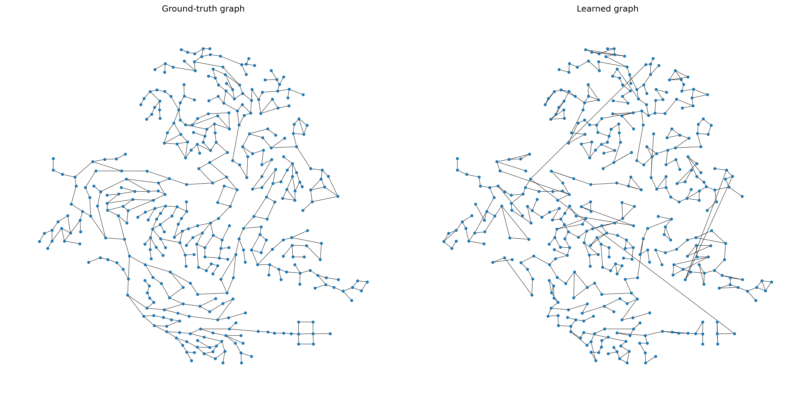
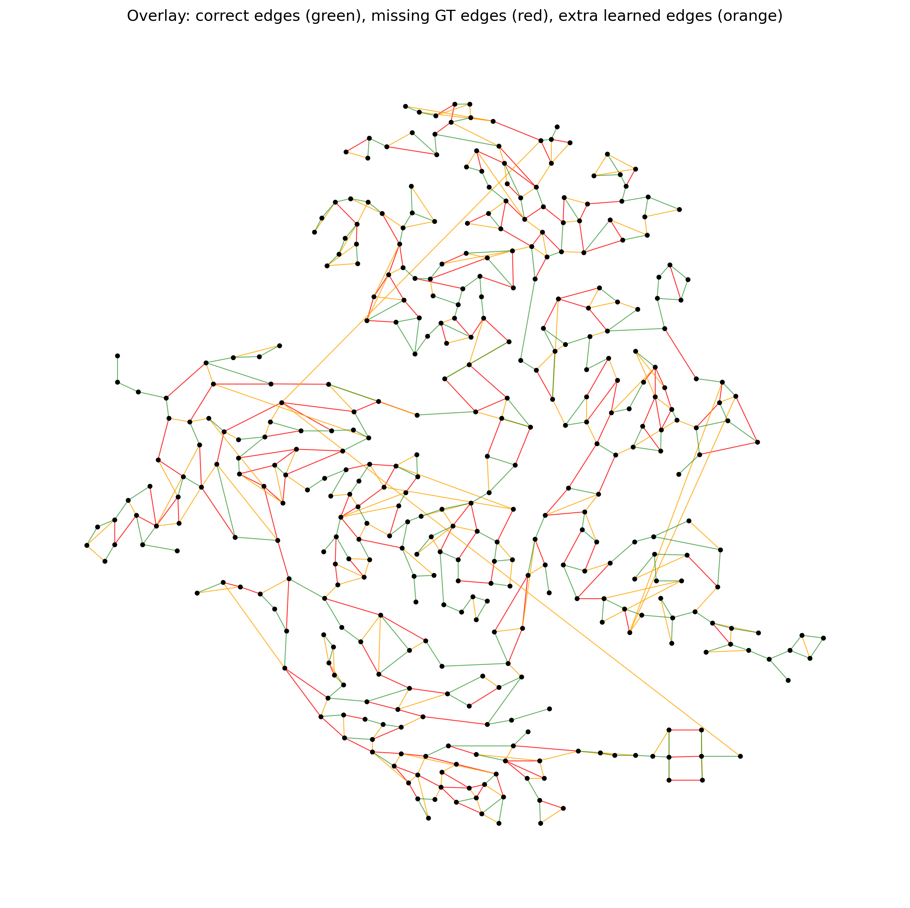

# C-Town Full-Network First Results

These are first full-network C-Town experiments. The graph has 396 nodes and
444 undirected ground-truth links. Ground-truth edges are used only for
evaluation and diagnostic post-processing sweeps, not inside training losses or
candidate construction.

## Observable Proxy Check

Before training DGM, we checked whether GT-free observable scores align with the
true C-Town topology. The best diagnostic scores were:

| Proxy / selector | F1 | Precision | Recall | Components |
| --- | ---: | ---: | ---: | ---: |
| `pressure_corr_row_knn_2` | 0.5535 | 0.5018 | 0.6171 | 54 |
| `geo_row_knn_2` | 0.5335 | 0.4980 | 0.5743 | 9 |
| `geo_top_budget` | 0.5090 | 0.5090 | 0.5090 | 70 |
| `geo_mst_plus_top` | 0.5023 | 0.5023 | 0.5023 | 1 |
| `geo_global_dynamic_proxy_mst_plus_top` | 0.4797 | 0.4797 | 0.4797 | 1 |

Interpretation: C-Town has a meaningful pressure-correlation signal, but the
raw pressure proxy is disconnected. Geometry/MST helps connectivity but costs
some local edge accuracy.

## DGM Full Run

Run:

```bash
python scripts/experiments/run_train_synthetic.py \
  --data_dir data/ctown_ts \
  --out_dir outputs/ctown_full_pressure_corr_a005_e20 \
  --run_name ctown_full_pressure_corr_a005_e20 \
  --num_nodes 396 \
  --lags 24 \
  --stride 24 \
  --max_epochs 20 \
  --check_val_every_n_epoch 2 \
  --batch_size 2 \
  --k 2 \
  --static_top_edges 444 \
  --use_complementary_loss \
  --alpha_forecast 0.05 \
  --lambda_graph 0.0 \
  --lambda_soft_pseudo_edge 1.0 \
  --pseudo_score_mode pressure_corr \
  --pseudo_use_static_target \
  --pseudo_topk 2 \
  --pseudo_include_mst \
  --assign_candidate_mask \
  --candidate_mode q_dynamic \
  --candidate_k 2 \
  --ensure_connected_consensus \
  --export_soft_graph \
  --save_soft_score
```

Loss:

```text
L = alpha * L_forecast + (1 - alpha) * L_topology
L_topology = L_soft_pseudo_edge
Q_ij = row-top-k(max(corr(p_i, p_j), 0)) plus geometric MST support
```

The C-Town loader now falls back to a geometric kNN initial graph when
`initial_edge_index` is missing, so the EPANET ground-truth edges are not used
as the model input graph.

## Topology Results

| Graph decoder | F1 | Precision | Recall | TP | FP | FN | Components |
| --- | ---: | ---: | ---: | ---: | ---: | ---: | ---: |
| consensus graph | 0.5495 | 0.5495 | 0.5495 | 244 | 200 | 200 | 1 |
| soft probability top-budget | 0.5653 | 0.5653 | 0.5653 | 251 | 193 | 193 | 1 |
| diagnostic soft sweep | 0.5811 | 0.5811 | 0.5811 | 258 | 186 | 186 | 1 |

The clean fixed-decoder result is the soft probability top-budget graph
(`F1=0.5653`). The diagnostic sweep selected a connected graph with
`gamma=0.0`, `tau=0.02`, no degree cap, and no forced MST. That sweep is useful
for analysis, but it is not a valid non-oracle model-selection result because
the best decoder setting is chosen after inspecting reconstruction metrics.





## Forecast Comparison

Forecast metrics are normalized.

| Model | MSE | RMSE | MAE | Pressure MSE | Demand MSE |
| --- | ---: | ---: | ---: | ---: | ---: |
| DGM topology-oriented | 0.4673 | 0.4755 | 0.2022 | 0.1508 | 0.3165 |
| node MLP forecast baseline | 0.0153 | 0.1236 | 0.0290 | 0.0098 | 0.0207 |

As expected, the baseline forecasts much better. The current DGM run is not
optimized to be the best forecaster; it is heavily weighted toward extracting a
topology from the forecasting-trained dynamic graph.

## Next Step

The next useful C-Town experiments are:

- sweep `alpha_forecast` to recover more forecasting ability without losing the
  topology signal;
- test `pressure_corr`, `geo_pressure_evidence`, and `geo_global_dynamic_proxy`
  as Q targets under the same 20-epoch protocol;
- replace the diagnostic soft sweep with a non-oracle decoder rule.
