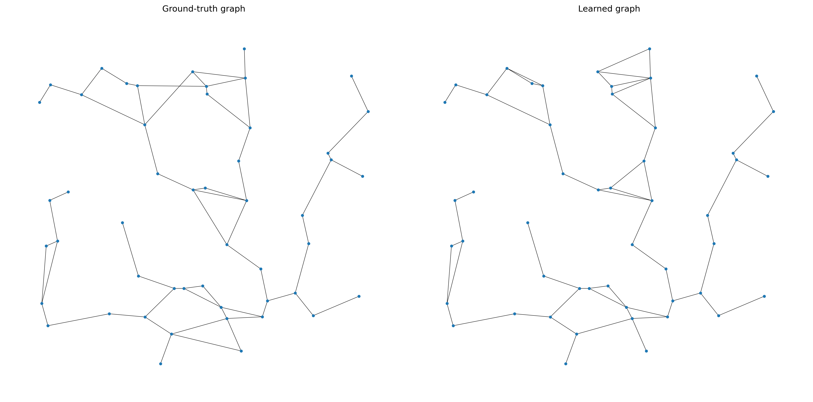
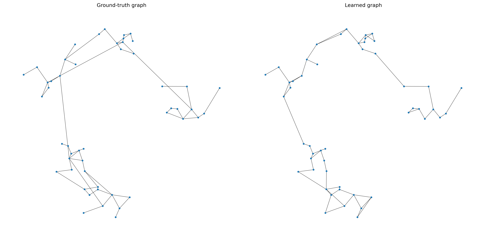
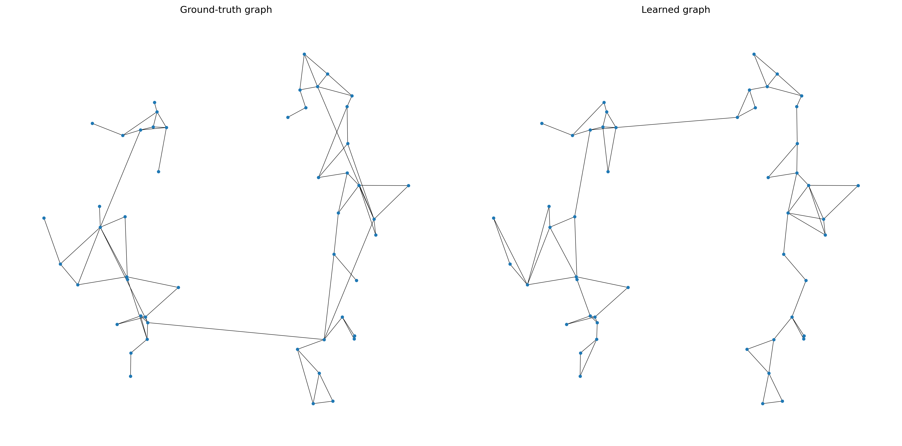
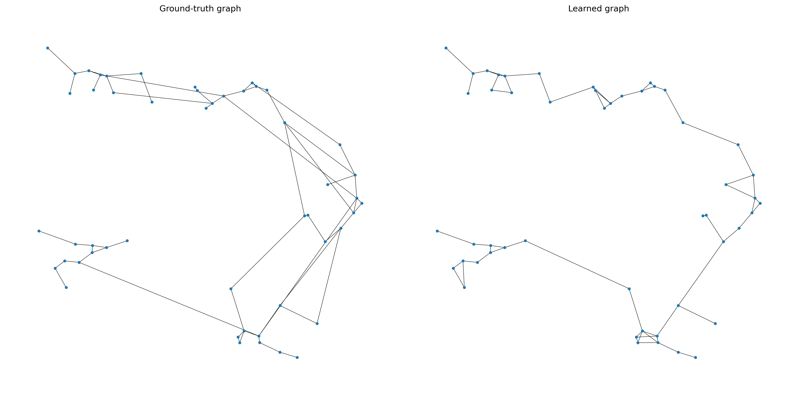

# Final Water-Like Benchmark Results

These results come from the final suite in `outputs/final_suite`.
Ground-truth edges are used only for evaluation and for the diagnostic decoder
sweep, never inside DGM training.

## Topology Reconstruction

| Benchmark/run | Best F1 | Precision | Recall | Components | Notes |
| --- | ---: | ---: | ---: | ---: | --- |
| `simple_a010_q2_mst_e80` | 0.9344 | 0.9344 | 0.9344 | 1 | Best overall controlled case. |
| `water_base_a002_q2_mst_e80` | 0.8254 | 0.8254 | 0.8254 | 1 | Water-branch base benchmark. |
| `water_base_a005_q2_mst_e80` | 0.8254 | 0.8254 | 0.8254 | 1 | Same topology score as alpha 0.02. |
| `water_base_a010_q2_mst_e80` | 0.8254 | 0.8254 | 0.8254 | 1 | Stable across alpha choices. |
| `water_bridges_a005_q3_mst_e80` | 0.8065 | 0.8065 | 0.8065 | 1 | Best bridge-heavy case. |
| `water_loopy_a010_q2_mst_e80` | 0.8082 | 0.8082 | 0.8082 | 1 | Best connected loopy case. |

The best decoder configuration is usually a length-penalized soft-score graph
with very small `tau` and, for branch-like cases, MST support. This confirms
that the DGM soft probabilities contain useful topology information, but the
static decoder still matters.

Representative visual comparisons:

- Simple benchmark: 
- Water base benchmark: 
- Water loopy benchmark: 
- Water bridge-heavy benchmark: 

## Forecast Baselines

Forecast metrics are computed on normalized pressure/demand, matching the DGM
training/evaluation scale.

| Run | Model | MSE | RMSE | MAE |
| --- | --- | ---: | ---: | ---: |
| `simple_forecast_node_mlp` | node MLP | 0.0017 | 0.0412 | 0.0276 |
| `simple_forecast_global_gru` | global GRU | 0.0019 | 0.0433 | 0.0284 |
| `water_base_forecast_node_mlp` | node MLP | 0.0019 | 0.0434 | 0.0313 |
| `water_loopy_forecast_node_mlp` | node MLP | 0.0020 | 0.0452 | 0.0328 |
| `water_bridges_forecast_node_mlp` | node MLP | 0.0021 | 0.0453 | 0.0328 |

The non-graph deep baselines forecast much better than the current DGM runs.
This is expected in the final DGM setting because the loss is deliberately
weighted toward topology reconstruction:

```text
L = 0.05 * L_forecast + 0.95 * L_topology
L_topology = L_soft_pseudo_edge
```

So the current scientific claim is not that DGM is the best forecaster. The
claim is that the forecasting-trained DGM, guided by observable geometry and
signal proxies, can expose a useful latent topology. A future stage should
jointly tune forecast quality and topology without losing the reconstructed
edge signal.

## Reproduce

```bash
python scripts/experiments/run_water_benchmark_suite.py --epochs 80
python scripts/experiments/collect_final_results.py --out_root outputs/final_suite
```

Main output files:

- `outputs/final_suite/topology_results.csv`
- `outputs/final_suite/forecast_results.csv`
- `outputs/final_suite/RESULTS.md`
